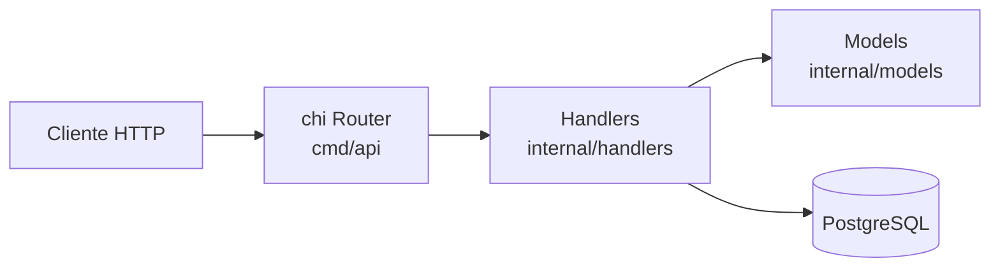

# ApiRestGo

API REST de cadastro de clientes escrita em **Go**, usando o router **chi** e **PostgreSQL** rodando via **Docker Compose**.

Projeto de estudo para praticar Go no backend: organização em camadas, `net/http` com chi e acesso a banco com `database/sql`.

> 🚧 **Em desenvolvimento.** A estrutura do projeto e o endpoint de criação estão implementados; listagem, atualização, remoção e a camada de acesso a dados estão no [roadmap](#-roadmap).


---

## 🧱 Arquitetura

A aplicação é separada em camadas, seguindo o layout comum de projetos Go (`cmd/` + `internal/`):



```
.
├── cmd/
│   └── api/
│       └── main.go              # ponto de entrada: conexão com o banco e rotas
├── internal/
│   ├── handlers/
│   │   └── cliente_handler.go   # handlers HTTP do recurso /clientes
│   └── models/
│       └── cliente.go           # struct Cliente (JSON)
├── docker-compose.yml           # PostgreSQL 15 para desenvolvimento
└── go.mod
```

- **`cmd/api`** — sobe o servidor HTTP na porta `8080` e registra as rotas no chi.
- **`internal/handlers`** — cada handler recebe o `*sql.DB` por injeção (closure), decodifica o JSON, executa a query e devolve a resposta.
- **`internal/models`** — structs de domínio com as tags de serialização JSON.

## 🔌 Endpoints

| Método | Rota | Descrição | Status |
|---|---|---|---|
| `POST` | `/clientes` | Cria um cliente | ✅ Implementado |
| `GET` | `/clientes` | Lista os clientes | 🚧 Em desenvolvimento |
| `PUT` | `/clientes/{id}` | Atualiza um cliente | 🚧 Em desenvolvimento |
| `DELETE` | `/clientes/{id}` | Remove um cliente | 🚧 Em desenvolvimento |

### Modelo `Cliente`

```json
{
  "id": 1,
  "nome": "Maria Silva",
  "email": "maria@exemplo.com"
}
```

### Exemplo — criar cliente

```bash
curl -X POST http://localhost:8080/clientes \
  -H "Content-Type: application/json" \
  -d '{"nome": "Maria Silva", "email": "maria@exemplo.com"}'
```

Resposta `201 Created`:

```json
{ "id": 1, "nome": "Maria Silva", "email": "maria@exemplo.com" }
```

## 🐳 Banco de dados local

As credenciais ficam em variáveis de ambiente. Crie seu `.env` a partir do modelo e defina sua senha:

```bash
cp .env.example .env
docker compose up -d
```

O PostgreSQL 15 sobe na porta `5432`.

## 🗺️ Roadmap

- [x] Estrutura em camadas (`cmd/` + `internal/`)
- [x] Router com chi
- [x] PostgreSQL via Docker Compose
- [x] Credenciais do banco em variáveis de ambiente (`.env`)
- [x] `POST /clientes`
- [ ] Camada `repository` (conexão com o banco via variáveis de ambiente)
- [ ] Migração SQL criando a tabela `clientes`
- [ ] `GET /clientes`, `PUT /clientes/{id}` e `DELETE /clientes/{id}`
- [ ] Validação de entrada e respostas de erro padronizadas em JSON
- [ ] Testes com `net/http/httptest`
- [ ] Dockerfile da API e serviço no Docker Compose

## 👩‍💻 Autora

**Caroline Brunheti** — Backend Developer

[LinkedIn](https://www.linkedin.com/in/carolinebrunheti/) · [GitHub](https://github.com/carolinebrunheti) · [caroline.brunheti@outlook.com](mailto:caroline.brunheti@outlook.com)
